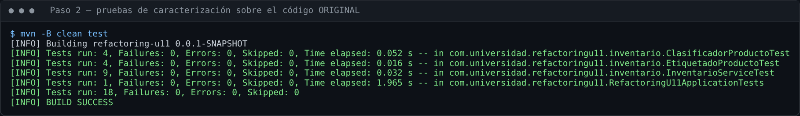
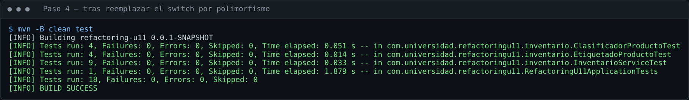
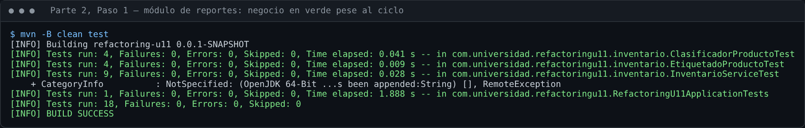
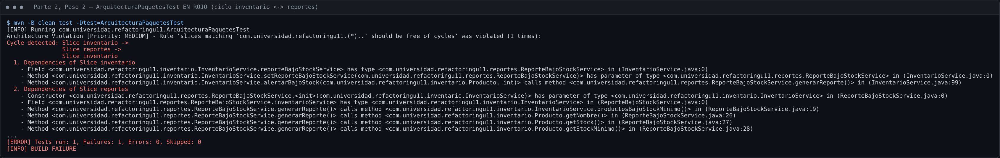
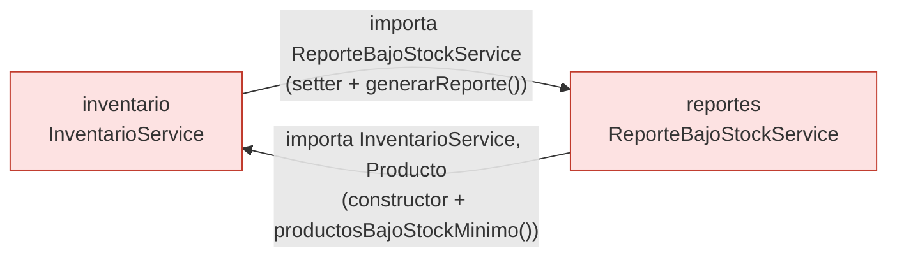
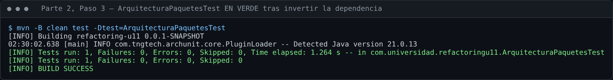
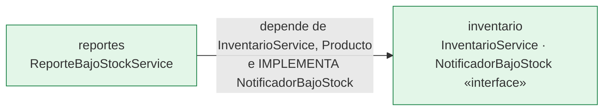
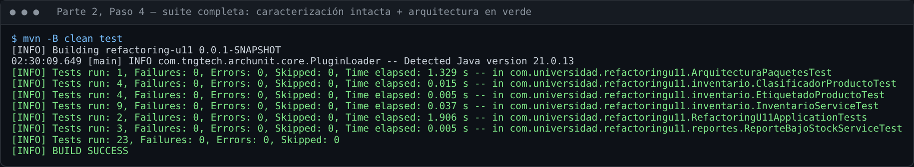

# refactoring-u11 — Refactorización guiada por pruebas: code smells, paquetes y acoplamiento

**Post-contenido U11 · Patrones de Diseño de Software · UDES**
Autor: Gustavo Adolfo Ordoñez Aguilar

Proyecto Spring Boot 3.3.5 (Java 17, ejecutado con JDK 21.0.13 y Maven 3.9.16) en forma de kata. Primero se blinda con pruebas de caracterización el código de inventario, que trae dos code smells. Después se refactoriza sin modificar esas pruebas. En la Parte 2 se diagnostica con ArchUnit una dependencia cíclica entre paquetes y se resuelve invirtiendo la dependencia.

```
src/main/java/com/universidad/refactoringu11/
├── RefactoringU11Application.java
├── inventario/   Producto, TipoProducto, InventarioService, ClasificadorProducto,
│                 EtiquetadoProducto, NotificadorBajoStock
└── reportes/     ReporteBajoStockService
src/test/java/com/universidad/refactoringu11/
├── ArquitecturaPaquetesTest.java, RefactoringU11ApplicationTests.java
├── inventario/   InventarioServiceTest, ClasificadorProductoTest, EtiquetadoProductoTest  (caracterización)
└── reportes/     ReporteBajoStockServiceTest
```

Cómo ejecutar: `mvn clean test` (todas las pruebas) o `mvn test -Dtest=ArquitecturaPaquetesTest` (solo la prueba de arquitectura).

> Todas las salidas que aparecen en este README son reales. Se obtuvieron ejecutando `mvn -B clean test` sobre el estado del código de cada commit. Las capturas están en [`docs/evidencias/`](docs/evidencias).

---

## Parte 1 — Red de seguridad y refactorización guiada por evidencia

### 1.1 Pruebas de caracterización (antes de tocar el código)

Las pruebas instancian las clases con `new`, sin levantar Spring, para que sean rápidas. Documentan el comportamiento **actual**, incluidos los casos límite:

| Clase de prueba | Casos | Qué fija |
|---|---|---|
| `InventarioServiceTest` | 9 | Los 4 tipos de retorno: `OK_n`, `ERROR_DATOS_INVALIDOS`, `ERROR_STOCK_INSUFICIENTE`, `OK_BAJO_STOCK_REORDEN_n`; también `ERROR_PRODUCTO_NO_EXISTE`. Casos límite: cantidad 0, id nulo, y una salida que deja el stock **exactamente** en el mínimo (`OK_5`, sin reorden, porque la condición es estricta `<`). |
| `ClasificadorProductoTest` | 4 | Las 4 ramas del switch de recargo (0, 8 %, 3 %, 2.50 fijo) |
| `EtiquetadoProductoTest` | 4 | Las 4 ramas del switch de etiqueta. La guía traía solo LIBRO y ELECTRONICO; se agregaron ROPA y ALIMENTO para cubrir el switch completo. |

Las pruebas se escribieron y ejecutaron **sobre el código original**: 18 pruebas en verde (17 de caracterización y `contextLoads`).



Desde ese commit los tres archivos de prueba **no se modificaron**. Se puede comprobar con:

```bash
git log --oneline -- src/test/java/com/universidad/refactoringu11/inventario/
# -> un único commit: "test: agregar pruebas de caracterizacion antes de refactorizar (red de seguridad)"
```

### 1.2 Smell 1 — Long Method en `InventarioService.actualizarInventario()`

**Evidencia antes:** el método ocupaba **44 líneas** (de la firma a la llave de cierre) y mezclaba **5 responsabilidades**:
1. validar la entrada;
2. buscar el producto;
3. actualizar el stock;
4. calcular la reorden;
5. registrar el movimiento y alertar.

Los comentarios del propio código las separaban, la señal clásica de que cada bloque pedía su propio método.

**Técnica aplicada:** *Extract Method* (Fowler, composición de métodos), en pasos pequeños con `mvn test` después de cada extracción.

**Después:** `actualizarInventario()` tiene **8 líneas** y solo orquesta:

```java
public String actualizarInventario(Long productoId, int cantidad, String tipoMovimiento) {
    if (!esSolicitudValida(productoId, cantidad, tipoMovimiento)) {
        return "ERROR_DATOS_INVALIDOS";
    }
    return buscarProducto(productoId)
            .map(producto -> aplicarMovimiento(producto, cantidad, tipoMovimiento))
            .orElse("ERROR_PRODUCTO_NO_EXISTE");
}
```

| Responsabilidad | Antes | Después |
|---|---|---|
| Validación de entrada | bloque `if` inline | `esSolicitudValida(...)` |
| Búsqueda | bucle `for` con `break` | `buscarProducto(...)` → `Optional<Producto>` |
| Actualización de stock | `if/else` inline | `calcularNuevoStock(...)` + `aplicarMovimiento(...)` |
| Política de reorden | expresión ternaria inline | `estaBajoStockMinimo(...)`, `calcularCantidadReorden(...)` |
| Auditoría | 4 líneas inline | `registrarMovimiento(...)` |
| Notificación | `println` inline | `alertarBajoStock(...)` |

El refactor conserva exactamente el orden de efectos: primero se registra el movimiento y luego sale la ALERTA. También conserva los mismos códigos de retorno y la misma comparación `tipoMovimiento.equals(...)`, para no cambiar ni siquiera el comportamiento con `null`, que no estaba cubierto por pruebas. Los "números mágicos" pasaron a constantes (`ENTRADA`, `SALIDA`, `FACTOR_REORDEN = 3`).


#### Decisión de diseño 1 — Cálculo de reorden: método privado, no clase `CalculadoraReorden`

**Decisión:** el cálculo queda como dos métodos privados de `InventarioService`: `estaBajoStockMinimo` y `calcularCantidadReorden`.

**Justificación:**
- La política actual es una sola expresión (`stockMinimo * 3 - stock`), no tiene estado ni colaboradores, y ninguna otra clase la necesita.
- Extraerla a una clase añadiría un bean, una dependencia más en el constructor y una prueba propia sin ganar nada hoy (YAGNI).
- Por eso se juzgó que **no tiene todavía una razón de cambio propia** distinta de la del servicio.

**Punto de reevaluación:** se extraería a `CalculadoraReorden` (o a una interfaz `PoliticaReorden`) en cuanto aparezca cualquiera de estos casos:
- reglas distintas por tipo de producto o por proveedor;
- demanda histórica o lead time;
- la necesidad de configurarla o de probarla de forma aislada.

En ese momento sí tendría un motivo de cambio propio, lo que justifica una clase según SRP. El método ya está aislado y nombrado, así que ese Extract Class sería mecánico.

### 1.3 Smell 2 — Switch Statements duplicados sobre `TipoProducto`

**Evidencia antes:** el mismo `switch (producto.getTipo())`, con las mismas 4 ramas (`LIBRO`, `ELECTRONICO`, `ROPA`, `ALIMENTO`) y el mismo `default` que lanza una excepción, aparecía en **dos clases**:

```
$ grep -rn "switch\|case " src/main/java       # en el commit original
ClasificadorProducto.java:7:   switch (producto.getTipo()) {
ClasificadorProducto.java:8-11:  case LIBRO / ELECTRONICO / ROPA / ALIMENTO
EtiquetadoProducto.java:7:     switch (producto.getTipo()) {
EtiquetadoProducto.java:8-11:    case LIBRO / ELECTRONICO / ROPA / ALIMENTO
```

Con ese diseño, agregar un tipo obligaba a editar ambas clases, y si se olvidaba una el error aparecía en tiempo de ejecución (en el `default`).

**Técnica aplicada:** *Replace Conditional with Polymorphism*. `TipoProducto` pasa a ser un enum con un método abstracto por comportamiento (`recargoEnvio(double precio)` y `etiqueta(String nombre)`) y una implementación por constante. Las dos clases delegan y **conservan su firma**:

```java
public double calcularRecargoEnvio(Producto producto) {
    return producto.getTipo().recargoEnvio(producto.getPrecio());
}
public String generarEtiqueta(Producto producto) {
    return producto.getTipo().etiqueta(producto.getNombre());
}
```

**Después:** `grep -rn "switch\|case " src/main/java` no devuelve **ninguna** coincidencia. Para agregar un tipo nuevo basta con añadir una constante al enum. El compilador **obliga** a implementar ambos métodos abstractos, y `ClasificadorProducto` y `EtiquetadoProducto` no se tocan.



#### Decisión de diseño 2 — Enum con métodos abstractos, no interfaz de estrategia por tipo

**Decisión:** se usa un enum con un cuerpo por constante.

**Justificación:**
- En este dominio el conjunto de tipos es **cerrado y estable**: son 4 valores que ya existían como enum.
- Cada comportamiento es una función pura de un dato del producto (precio o nombre), sin dependencias externas.
- El enum mantiene juntas la identidad del tipo y su comportamiento, no añade clases y da exhaustividad comprobada por el compilador.
- Una jerarquía `EstrategiaTipo` con 4 clases, más un registro o un mapa para resolverlas, costaría unas 6 clases adicionales y un punto de búsqueda en tiempo de ejecución que hoy no aporta nada.

**Límite reconocido:** las constantes de un enum no reciben inyección de Spring. Si mañana un tipo necesitara un colaborador (por ejemplo, un servicio de tarifas de un transportista), la opción correcta sería migrar a una interfaz de estrategia con un `@Component` por tipo, inyectados como `Map<TipoProducto, Estrategia>`. Ese cambio sería local, porque `Clasificador` y `Etiquetado` ya delegan en un único punto.

### 1.4 Resumen de evidencia de la Parte 1

| Momento | `mvn test` | Resultado |
|---|---|---|
| Código original + pruebas de caracterización | Tests run: **18**, Failures: 0, Errors: 0 | BUILD SUCCESS |
| Tras eliminar el Long Method | Tests run: **18**, Failures: 0, Errors: 0 | BUILD SUCCESS |
| Tras eliminar el switch duplicado | Tests run: **18**, Failures: 0, Errors: 0 | BUILD SUCCESS |

| Métrica | Antes | Después |
|---|---|---|
| Líneas de `actualizarInventario()` | 44 | 8 |
| Responsabilidades en `actualizarInventario()` | 5 | 1 (orquestar) |
| `switch` sobre `TipoProducto` | 2 (en 2 clases) | 0 |
| Clases a editar para agregar un tipo | 3 (enum + 2 clases) | 1 (enum) |
| Archivos de prueba de caracterización modificados | — | 0 |

---

## Parte 2 — Diagnóstico y resolución de acoplamiento entre paquetes

### 2.1 Módulo de reportes (introduce el ciclo)

Se agregó `archunit-junit5 1.3.0` (scope test) y el paquete `reportes` con `ReporteBajoStockService`. Esta clase recibe `InventarioService` por constructor y usa el nuevo método `productosBajoStockMinimo()` para generar un reporte de texto. A su vez, `InventarioService` recibe `ReporteBajoStockService` por **setter** (`@Autowired(required = false)`) y lo invoca desde la rama de bajo stock, siempre protegido por el guard `!= null`.

> **Nota técnica (Spring Boot 2.6+):** con referencias circulares entre beans el contexto **no arranca** (`BeanCurrentlyInCreationException`), porque `spring.main.allow-circular-references` es `false` por defecto. Por eso el parámetro del setter lleva `@Lazy`: Spring inyecta un proxy perezoso y `contextLoads` sigue en verde. `@Lazy` solo esconde el síntoma en tiempo de ejecución. **No** elimina el ciclo entre paquetes, como demuestra la prueba de arquitectura.

Con el ciclo ya presente, las pruebas de negocio siguen **en verde** (18/18): el problema es de arquitectura, no de comportamiento.



### 2.2 Diagnóstico con ArchUnit (en rojo)

`ArquitecturaPaquetesTest` exige que los paquetes de primer nivel (`com.universidad.refactoringu11.(*)..`) estén libres de ciclos. Ejecutada en este punto, **falla**:

```
$ mvn -B clean test -Dtest=ArquitecturaPaquetesTest
Architecture Violation [Priority: MEDIUM] - Rule 'slices matching 'com.universidad.refactoringu11.(*)..' should be free of cycles' was violated (1 times):
Cycle detected: Slice inventario ->
                Slice reportes ->
                Slice inventario
  1. Dependencies of Slice inventario
    - Field <...inventario.InventarioService.reporteBajoStockService> has type <...reportes.ReporteBajoStockService>
    - Method <...inventario.InventarioService.setReporteBajoStockService(...reportes.ReporteBajoStockService)> has parameter of type <...>
    - Method <...inventario.InventarioService.alertarBajoStock(...)> calls method <...reportes.ReporteBajoStockService.generarReporte()> in (InventarioService.java:99)
  2. Dependencies of Slice reportes
    - Constructor <...reportes.ReporteBajoStockService.<init>(...inventario.InventarioService)> has parameter of type <...>
    - Method <...reportes.ReporteBajoStockService.generarReporte()> calls method <...inventario.InventarioService.productosBajoStockMinimo()>
    ...
[ERROR] Tests run: 1, Failures: 1, Errors: 0, Skipped: 0
[INFO] BUILD FAILURE
```



**Diagrama de paquetes — ANTES (con ciclo):**



```
   ┌──────────────┐  inventario → reportes   ┌──────────────┐
   │  inventario  │ ───────────────────────▶ │   reportes   │
   │              │ ◀─────────────────────── │              │
   └──────────────┘  reportes → inventario   └──────────────┘
                         ⟲ CICLO
```

En la suite completa de este commit, las 18 pruebas de negocio pasan y solo falla la de arquitectura (`Tests run: 19, Failures: 1`).

### 2.3 Resolución: inversión de dependencias con `NotificadorBajoStock`

Se extrae la abstracción **en el paquete `inventario`**:

```java
package com.universidad.refactoringu11.inventario;

public interface NotificadorBajoStock {
    void notificar(Producto producto, int cantidadReorden);
}
```

- `InventarioService` depende solo de la interfaz (`setNotificador(@Lazy NotificadorBajoStock)`) y ya **no importa nada de `reportes`**. Se puede verificar con `grep -rn "^import .*reportes" src/main/java/com/universidad/refactoringu11/inventario/`, que no devuelve resultados.
- `ReporteBajoStockService implements NotificadorBajoStock`:
  - `notificar(...)` registra la alerta (`"Clean Code -> reordenar 12 unidades"`);
  - `generarReporte()` lista los productos bajo el mínimo junto con las alertas recibidas.
- La única flecha entre paquetes queda en el sentido permitido: `reportes → inventario`.

```
$ mvn -B clean test -Dtest=ArquitecturaPaquetesTest
[INFO] Tests run: 1, Failures: 0, Errors: 0, Skipped: 0, Time elapsed: 1.264 s -- in com.universidad.refactoringu11.ArquitecturaPaquetesTest
[INFO] Tests run: 1, Failures: 0, Errors: 0, Skipped: 0
[INFO] BUILD SUCCESS
```



**Diagrama de paquetes — DESPUÉS (sin ciclo):**



```
   ┌──────────────────────────┐                     ┌──────────────┐
   │        inventario        │ ◀────────────────── │   reportes   │
   │  InventarioService ──▶   │   reportes →        │ ReporteBajo- │
   │  «NotificadorBajoStock»  │   inventario        │ StockService │
   └──────────────────────────┘   (única flecha)    └──────────────┘
```

### 2.4 El comportamiento no cambió

La suite completa se ejecutó **sin modificar una sola línea** de `InventarioServiceTest`, `ClasificadorProductoTest` ni `EtiquetadoProductoTest`. Sus 17 pruebas siguen en verde, igual que la de arquitectura. Además se añadieron pruebas nuevas, en archivos separados, para la colaboración `inventario → notificador`:
- `ReporteBajoStockServiceTest`, con 3 pruebas;
- `springInyectaElNotificadorEnInventario`, que comprueba con el contexto real de Spring que el bean de reportes queda inyectado como `NotificadorBajoStock`.

| Momento | ArquitecturaPaquetesTest | Pruebas de caracterización | Total |
|---|---|---|---|
| Con el ciclo (commit "en rojo") | ❌ 1 failure | ✅ 17/17 | 19 run, 1 failure |
| Tras invertir la dependencia | ✅ | ✅ 17/17 (sin modificar) | **23 run, 0 failures, BUILD SUCCESS** |



#### Decisión de diseño 3 — `NotificadorBajoStock` vive en `inventario`, no en `reportes`

Según la regla de la Guía de Contenido (sección 4.3), *los paquetes de infraestructura dependen de dominio; dominio nunca depende de infraestructura*.

- En este proyecto **`inventario` es el paquete de mayor nivel de abstracción**. Contiene el modelo y las reglas de negocio (stock, mínimos, política de reorden), que son estables y valiosas por sí mismas.
- **`reportes` es un detalle de menor nivel**: una forma concreta de consumir esos eventos, que podría cambiarse por correo, Slack o una cola sin que el dominio se entere.
- Quien define la abstracción es quien la necesita (el cliente, según DIP). `inventario` declara "necesito que alguien sea notificado del bajo stock" y no le importa quién.
- Si la interfaz viviera en `reportes`, `inventario` seguiría importando `reportes` y el ciclo se mantendría.

#### Decisión de diseño 4 — Granularidad por evento: `notificar(Producto, cantidadReorden)`

**Decisión:** se notifica por evento individual.

**Justificación:**
- La detección de bajo stock ocurre **dentro de un movimiento individual**: un `actualizarInventario` afecta a un único producto. Notificar en ese mismo punto mantiene la causa y el efecto juntos y conserva el contexto exacto (la cantidad de reorden ya calculada).
- El dominio no necesita acumular estado ni decidir cuándo "cerrar" un lote.
- Cada evento es pequeño y fácil de probar, como muestra `ReporteBajoStockServiceTest`.
- Quien quiera agrupar (como el propio `ReporteBajoStockService`, que acumula alertas para su reporte) puede hacerlo del lado del implementador.

**Cuándo preferir un lote** (`notificar(List<Producto>)`):
- cuando el inventario se actualiza por procesos masivos (importación nocturna, cierre de inventario, sincronización con el ERP);
- cuando cada notificación tiene un costo alto (un correo, una llamada HTTP a proveedores, una orden de compra consolidada).

En esos casos, agrupar evita cientos de mensajes y permite consolidar la reorden por proveedor. Si llegara a hacer falta, se puede añadir sin romper el contrato actual, por ejemplo con un método `default` que itere sobre el lote o con un decorador que acumule eventos.

---

## Historial de commits

| # | Commit | Estado de las pruebas |
|---|---|---|
| 1 | `feat: crear inventario con Long Method ... y switch duplicado ...` | 1 (contextLoads) ✅ |
| 2 | `test: agregar pruebas de caracterizacion antes de refactorizar (red de seguridad)` | 18 ✅ |
| 3 | `refactor: eliminar Long Method en actualizarInventario ...` | 18 ✅ |
| 4 | `refactor: eliminar switch duplicado sobre TipoProducto con polimorfismo` | 18 ✅ |
| 5 | `docs: documentar evidencia de code smells, decisiones de diseno y resultado de pruebas` | — |
| 6 | `feat: agregar modulo de reportes con notificacion de bajo stock desde inventario` | 18 ✅ |
| 7 | `test: agregar prueba de arquitectura que detecta ciclo ... (en rojo)` | 19, **1 ❌ (esperado)** |
| 8 | `refactor: invertir la dependencia entre inventario y reportes extrayendo NotificadorBajoStock` | 23 ✅ |
| 9 | `docs: completar README con diagrama de paquetes antes/despues y decisiones de la Parte 2` | 23 ✅ |

Las salidas completas de Maven de cada etapa están en [`docs/evidencias/salidas-maven/`](docs/evidencias/salidas-maven).

## Referencias

- Fowler, M. (2018). *Refactoring: Improving the design of existing code* (2.ª ed.). Addison-Wesley.
- Feathers, M. C. (2004). *Working effectively with legacy code*. Prentice Hall.
- Martin, R. C. (2017). *Clean architecture: A craftsman's guide to software structure and design*. Prentice Hall.
- TNG Technology Consulting. (2024). *ArchUnit user guide* (v1.3.0). https://www.archunit.org/userguide/html/000_Index.html
