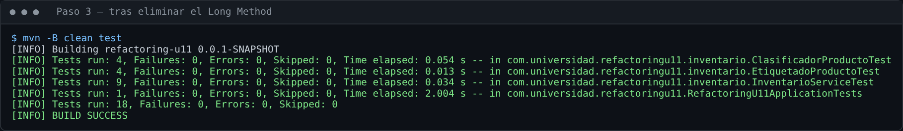

# refactoring-u11 — Refactorización guiada por pruebas: code smells, paquetes y acoplamiento

**Post-contenido U11 · Patrones de Diseño de Software · UDES**
Autor: Gustavo Adolfo Ordoñez Aguilar

Proyecto Spring Boot 3.3.5 (Java 17, ejecutado con JDK 21.0.13 y Maven 3.9.16) en forma de kata. Primero se blinda con pruebas de caracterización el código de inventario, que trae dos code smells. Después se refactoriza sin modificar esas pruebas. En la Parte 2 se diagnostica con ArchUnit una dependencia cíclica entre paquetes y se resuelve invirtiendo la dependencia.

```
src/main/java/com/universidad/refactoringu11/
├── RefactoringU11Application.java
└── inventario/   Producto, TipoProducto, InventarioService, ClasificadorProducto, EtiquetadoProducto
src/test/java/com/universidad/refactoringu11/
├── RefactoringU11ApplicationTests.java
└── inventario/   InventarioServiceTest, ClasificadorProductoTest, EtiquetadoProductoTest  (caracterización)
```

Cómo ejecutar: `mvn clean test`.

> Todas las salidas que aparecen en este README son reales. Se obtuvieron ejecutando `mvn -B clean test` sobre el estado del código de cada commit. Las capturas están en [`docs/evidencias/`](docs/evidencias).

---

## Parte 1 — Red de seguridad y refactorización guiada por evidencia

### 1.1 Pruebas de caracterización (antes de tocar el código)

Las pruebas instancian las clases con `new`, sin levantar Spring, para que sean rápidas. Documentan el comportamiento **actual**, incluidos los casos límite:

| Clase de prueba | Casos | Qué fija |
|---|---|---|
| `InventarioServiceTest` | 9 | Los 4 tipos de retorno: `OK_n`, `ERROR_DATOS_INVALIDOS`, `ERROR_STOCK_INSUFICIENTE`, `OK_BAJO_STOCK_REORDEN_n`; también `ERROR_PRODUCTO_NO_EXISTE`. Casos límite: cantidad 0, id nulo, y una salida que deja el stock **exactamente** en el mínimo (`OK_5`, sin reorden, porque la condición es estricta `<`). |
| `ClasificadorProductoTest` | 4 | Las 4 ramas del switch de recargo (0, 8 %, 3 %, 2.50 fijo) |
| `EtiquetadoProductoTest` | 4 | Las 4 ramas del switch de etiqueta. La guía traía solo LIBRO y ELECTRONICO; se agregaron ROPA y ALIMENTO para cubrir el switch completo. |

Las pruebas se escribieron y ejecutaron **sobre el código original**: 18 pruebas en verde (17 de caracterización y `contextLoads`).


Desde ese commit los tres archivos de prueba **no se modificaron**. Se puede comprobar con:

```bash
git log --oneline -- src/test/java/com/universidad/refactoringu11/inventario/
# -> un único commit: "test: agregar pruebas de caracterizacion antes de refactorizar (red de seguridad)"
```

### 1.2 Smell 1 — Long Method en `InventarioService.actualizarInventario()`

**Evidencia antes:** el método ocupaba **44 líneas** (de la firma a la llave de cierre) y mezclaba **5 responsabilidades**:
1. validar la entrada;
2. buscar el producto;
3. actualizar el stock;
4. calcular la reorden;
5. registrar el movimiento y alertar.

Los comentarios del propio código las separaban, la señal clásica de que cada bloque pedía su propio método.

**Técnica aplicada:** *Extract Method* (Fowler, composición de métodos), en pasos pequeños con `mvn test` después de cada extracción.

**Después:** `actualizarInventario()` tiene **8 líneas** y solo orquesta:

```java
public String actualizarInventario(Long productoId, int cantidad, String tipoMovimiento) {
    if (!esSolicitudValida(productoId, cantidad, tipoMovimiento)) {
        return "ERROR_DATOS_INVALIDOS";
    }
    return buscarProducto(productoId)
            .map(producto -> aplicarMovimiento(producto, cantidad, tipoMovimiento))
            .orElse("ERROR_PRODUCTO_NO_EXISTE");
}
```

| Responsabilidad | Antes | Después |
|---|---|---|
| Validación de entrada | bloque `if` inline | `esSolicitudValida(...)` |
| Búsqueda | bucle `for` con `break` | `buscarProducto(...)` → `Optional<Producto>` |
| Actualización de stock | `if/else` inline | `calcularNuevoStock(...)` + `aplicarMovimiento(...)` |
| Política de reorden | expresión ternaria inline | `estaBajoStockMinimo(...)`, `calcularCantidadReorden(...)` |
| Auditoría | 4 líneas inline | `registrarMovimiento(...)` |
| Notificación | `println` inline | `alertarBajoStock(...)` |

El refactor conserva exactamente el orden de efectos: primero se registra el movimiento y luego sale la ALERTA. También conserva los mismos códigos de retorno y la misma comparación `tipoMovimiento.equals(...)`, para no cambiar ni siquiera el comportamiento con `null`, que no estaba cubierto por pruebas. Los "números mágicos" pasaron a constantes (`ENTRADA`, `SALIDA`, `FACTOR_REORDEN = 3`).



#### Decisión de diseño 1 — Cálculo de reorden: método privado, no clase `CalculadoraReorden`

**Decisión:** el cálculo queda como dos métodos privados de `InventarioService`: `estaBajoStockMinimo` y `calcularCantidadReorden`.

**Justificación:**
- La política actual es una sola expresión (`stockMinimo * 3 - stock`), no tiene estado ni colaboradores, y ninguna otra clase la necesita.
- Extraerla a una clase añadiría un bean, una dependencia más en el constructor y una prueba propia sin ganar nada hoy (YAGNI).
- Por eso se juzgó que **no tiene todavía una razón de cambio propia** distinta de la del servicio.

**Punto de reevaluación:** se extraería a `CalculadoraReorden` (o a una interfaz `PoliticaReorden`) en cuanto aparezca cualquiera de estos casos:
- reglas distintas por tipo de producto o por proveedor;
- demanda histórica o lead time;
- la necesidad de configurarla o de probarla de forma aislada.

En ese momento sí tendría un motivo de cambio propio, lo que justifica una clase según SRP. El método ya está aislado y nombrado, así que ese Extract Class sería mecánico.

### 1.3 Smell 2 — Switch Statements duplicados sobre `TipoProducto`

**Evidencia antes:** el mismo `switch (producto.getTipo())`, con las mismas 4 ramas (`LIBRO`, `ELECTRONICO`, `ROPA`, `ALIMENTO`) y el mismo `default` que lanza una excepción, aparecía en **dos clases**:

```
$ grep -rn "switch\|case " src/main/java       # en el commit original
ClasificadorProducto.java:7:   switch (producto.getTipo()) {
ClasificadorProducto.java:8-11:  case LIBRO / ELECTRONICO / ROPA / ALIMENTO
EtiquetadoProducto.java:7:     switch (producto.getTipo()) {
EtiquetadoProducto.java:8-11:    case LIBRO / ELECTRONICO / ROPA / ALIMENTO
```

Con ese diseño, agregar un tipo obligaba a editar ambas clases, y si se olvidaba una el error aparecía en tiempo de ejecución (en el `default`).

**Técnica aplicada:** *Replace Conditional with Polymorphism*. `TipoProducto` pasa a ser un enum con un método abstracto por comportamiento (`recargoEnvio(double precio)` y `etiqueta(String nombre)`) y una implementación por constante. Las dos clases delegan y **conservan su firma**:

```java
public double calcularRecargoEnvio(Producto producto) {
    return producto.getTipo().recargoEnvio(producto.getPrecio());
}
public String generarEtiqueta(Producto producto) {
    return producto.getTipo().etiqueta(producto.getNombre());
}
```

**Después:** `grep -rn "switch\|case " src/main/java` no devuelve **ninguna** coincidencia. Para agregar un tipo nuevo basta con añadir una constante al enum. El compilador **obliga** a implementar ambos métodos abstractos, y `ClasificadorProducto` y `EtiquetadoProducto` no se tocan.


#### Decisión de diseño 2 — Enum con métodos abstractos, no interfaz de estrategia por tipo

**Decisión:** se usa un enum con un cuerpo por constante.

**Justificación:**
- En este dominio el conjunto de tipos es **cerrado y estable**: son 4 valores que ya existían como enum.
- Cada comportamiento es una función pura de un dato del producto (precio o nombre), sin dependencias externas.
- El enum mantiene juntas la identidad del tipo y su comportamiento, no añade clases y da exhaustividad comprobada por el compilador.
- Una jerarquía `EstrategiaTipo` con 4 clases, más un registro o un mapa para resolverlas, costaría unas 6 clases adicionales y un punto de búsqueda en tiempo de ejecución que hoy no aporta nada.

**Límite reconocido:** las constantes de un enum no reciben inyección de Spring. Si mañana un tipo necesitara un colaborador (por ejemplo, un servicio de tarifas de un transportista), la opción correcta sería migrar a una interfaz de estrategia con un `@Component` por tipo, inyectados como `Map<TipoProducto, Estrategia>`. Ese cambio sería local, porque `Clasificador` y `Etiquetado` ya delegan en un único punto.

### 1.4 Resumen de evidencia de la Parte 1

| Momento | `mvn test` | Resultado |
|---|---|---|
| Código original + pruebas de caracterización | Tests run: **18**, Failures: 0, Errors: 0 | BUILD SUCCESS |
| Tras eliminar el Long Method | Tests run: **18**, Failures: 0, Errors: 0 | BUILD SUCCESS |
| Tras eliminar el switch duplicado | Tests run: **18**, Failures: 0, Errors: 0 | BUILD SUCCESS |

| Métrica | Antes | Después |
|---|---|---|
| Líneas de `actualizarInventario()` | 44 | 8 |
| Responsabilidades en `actualizarInventario()` | 5 | 1 (orquestar) |
| `switch` sobre `TipoProducto` | 2 (en 2 clases) | 0 |
| Clases a editar para agregar un tipo | 3 (enum + 2 clases) | 1 (enum) |
| Archivos de prueba de caracterización modificados | — | 0 |

## Referencias

- Fowler, M. (2018). *Refactoring: Improving the design of existing code* (2.ª ed.). Addison-Wesley.
- Feathers, M. C. (2004). *Working effectively with legacy code*. Prentice Hall.
